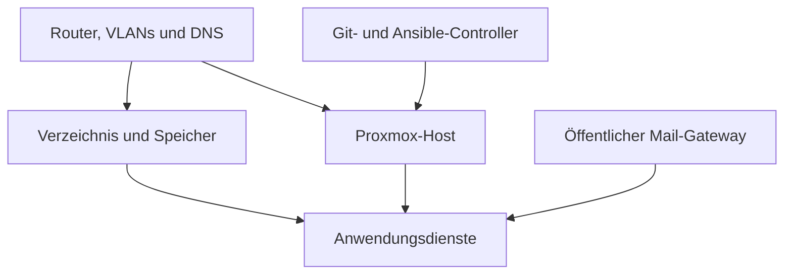

<!-- bergen-platform-handbook: managed -->
# Architektur und Bestandsaufnahme

[Deutsch](DE-Start.md) | [English](EN-Architecture.md)

**Öffentliche Ausgabe 1.0, 14.10.2026.** Beispiele ersetzen keine private Standortkonfiguration.

## Was ist die Bergen-Platform?

Die Bergen-Platform stellt selbst betreute Dienste für ihre Nutzer bereit. Mehrere kleine Dienste teilen sich Netzwerk, Benutzerverwaltung und Server.

### Ein Haus mit mehreren Aufgaben
Der **Router** verbindet das Heimnetz mit dem Internet. **Switches** verteilen Kabelverbindungen. **Access Points** stellen WLAN bereit. Das **NAS** ist ein eigener Speicher- und Diensterechner. Auf **dem Proxmox-Host** betreibt Proxmox mehrere getrennte Linux-Umgebungen.

### Die wichtigsten Abhängigkeiten
DNS übersetzt Namen in Adressen. LDAP prüft bei mehreren Diensten Benutzerkonten. Fallen diese zentralen Aufgaben aus, können mehrere Anwendungen gleichzeitig gestört sein, obwohl ihre Container noch laufen. Netz- und Speicherprobleme deshalb vor einzelnen Anwendungen prüfen.

Der öffentliche Mail-Gateway liegt außerhalb des Hauses. Seine Internet-Erreichbarkeit und der private Weg zum Heimnetz sind eigenständige Fehlerquellen. Die dargestellte Backend-Anbindung ist die dokumentierte Zielarchitektur; der aktive Postfachstand muss vor Ort festgestellt werden.

### Konfiguration und Daten sind zwei verschiedene Dinge
Git und Ansible beschreiben, wie Dienste eingerichtet werden. Sie enthalten nicht automatisch die E-Mails, Dokumente, Fotos, Datenbanken oder sämtliche privaten Einstellungen. Ein neues System aus Code aufzubauen stellt verlorene Familieninhalte nicht wieder her.

**Merksatz:** Für eine Übernahme werden Bauplan, private Standortkonfiguration, Zugänge und wiederherstellbare Daten gemeinsam gebraucht.

---

[Inhalt](DE-Start.md) · [Quellen](DE-Sources.md) · [Private Übergabe vorbereiten](DE-Handover.md)
