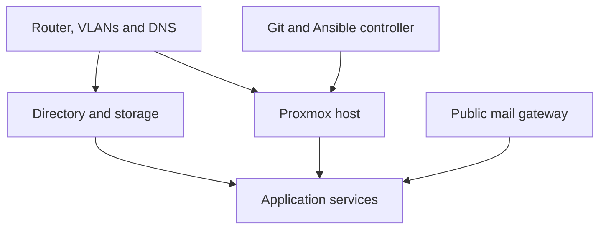

<!-- bergen-platform-handbook: managed -->
# Architecture and the private inventory

[Deutsch](DE-Architecture.md) | [English](EN-Start.md)

**Public edition 1.0, 2026-10-14.** Examples do not replace a private deployment inventory.

## One platform, several responsibilities

The router connects networks to the internet. Switches distribute wired connections; access points provide Wi-Fi. A NAS provides storage and may also run DNS and directory services. The Proxmox host runs separate Linux guests, each with its own resource, network and storage assignments.

This describes responsibilities, not a complete firewall diagram or a claim that every optional service is deployed. The public mail gateway is a separate system outside the local application host. Its connection to a backend must be recorded and verified independently.

## Dependencies explain widespread failures

DNS translates service names into addresses. LDAP supplies identities and group information. If either fails, several applications may appear broken even while their containers are running. Check central network, identity and storage dependencies before changing every affected application.

The controller holds the Git working copy, Ansible environment and private deployment settings. Applications generally continue operating without a controller login. Losing the controller still matters: it can prevent reliable administration or reconstruction.

## Code and family content are different

Git and Ansible describe how to create or configure services. They do not automatically contain mailboxes, documents, photos, database contents, every local setting or private key. Recreating a service from code does not recreate missing personal content.

A complete takeover needs the public build description, private deployment settings, usable administrative access and recoverable data together.

## Make a private inventory

For each service record its purpose, actual host and guest ID, address, user-facing URL, version, persistent paths, database, external storage, administrator route, backup job and restore evidence. Mark it operational, prepared, evaluation-only or retired.

Record the active mailbox source explicitly. A newly installed backend and a repaired public certificate do not prove that every mailbox has migrated. Likewise, a Paperless feature branch does not prove an accepted archive is running.

Typical groups to record are network and telephony; NAS/DNS/LDAP; Proxmox; controller; mail gateway and backend; Pi-hole; Nextcloud; EVCC; MQTT/Homey; Paperless; proxy; logs; and any AI or market-data components.

## Set priorities

First preserve basic connectivity, names, identities and storage. Then protect the actual mailboxes and important file/document services. Charging and home automation need a usable fallback. Development labs and optional AI usually have lower initial priority, unless the private inventory explains a real dependency.

Neither an application name nor a green container status tells you where valuable data lives. The private inventory supplies that answer.

---

[Contents](EN-Start.md) · [Sources](EN-Sources.md) · [Prepare private handover](EN-Handover.md)
